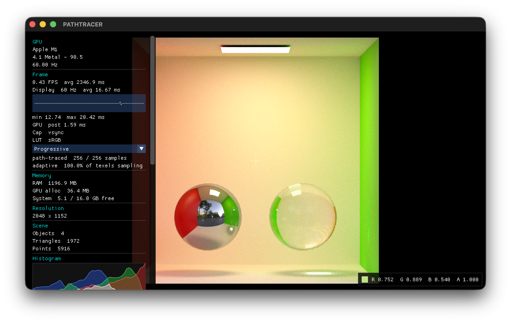

# PBR Pathtracer

*A physically-based spectral, unidirectional Monte Carlo path tracer with progressive sampling: hero-wavelength transport projected to ACEScg, Embree-accelerated, stochastic BSDF combined with environment and area-light NEE via MIS over a per-path vertex graph, behind a thin OpenGL display/HUD layer.*



## Build

C++20, built with CMake. Currently developed against macOS only.

```
brew install cmake glfw glew glm imath openexr opencolorio openimageio embree open-image-denoise openvdb boost
```
```
git submodule update --init --recursive
cmake -B build
cmake --build build
```

## Run

```
./build/pathtracer [-scene path/to/scene.json] [-preset beauty|proxy|research] [-stats] [-bench log.jsonl] [-bench-aovs beauty,normal,...] [-size WxH] [-spp N]
```

## Presets

`assets/config/profile.json` holds every setting. Each file in `assets/config/presets/` is a named preset and an RFC 7396 merge
patch over it. Select one with `-preset NAME`, `render_beauty --preset NAME`, `Renderer(scene, preset="NAME")` or
`pt_renderer_open(..., "NAME", ...)`. `beauty.json` is empty, so beauty is `profile.json` as is. An override may only replace keys
`profile.json` has, kind for kind, and anything else is refused at load.

| Preset | Size | spp | Interactive scale | Camera |
| --- | --- | --- | --- | --- |
| beauty (default) | 2048x1152 | 64 | 0.1 | square pixels, rectilinear lens |
| `proxy` | 512x256 | 16 | 1.0 | as beauty |
| `research` | 64x32 | 64 | 1.0 | hexagonal pixels, omnidirectional lens |

`proxy` is the benchmark workload: `-bench`, `render_beauty` and `gbuffer_bench` default to its size and samples.

A preset sets the sensor, never the pose: a scene's `camera` block places it. `scenes/cornell_research.json` is Cornell seen
from inside the box, the scene `research` is made for.

## Test

```
cmake -B build -DPython3_EXECUTABLE=/path/to/python   # with pytest, numpy, OpenEXR and Imath, so api.python is registered
ctest --test-dir build -j4
ctest --test-dir build -C Calibration -L calibration -j8   # opt-in, ~40 min: how often each statistical test fails by chance
```

Every statistical test draws its seed from the harness and derives its band from its own standard error and the suite's alpha.
Calibration reports UNSEEDED or UNDERIVED for a test that does not, and fails it.

The `display_gl` tests open a hidden OpenGL window and report Not Run where none can be created.

## Controls

| Input | Action |
| --- | --- |
| `W` / `S` | Fly forward / back |
| `A` / `D` | Fly left / right |
| `Q` / `E` | Fly down / up |
| LMB drag | Orbit about the surface under the view centre |
| `0` | Reset camera to the profile's pose |
| `L` | Cycle viewer LUT: sRGB -> Rec.709 -> Raw |
| `R` / `G` / `B` | Isolate a channel; the active one again clears it |
| `I` | Invert the display |
| `H` | Toggle the HUD |
| `Cmd` + `-` / `=` | Zoom the image out / in by powers of two; it opens fitted to the window and never zooms past fit |
| `Esc` | Quit |

## Python

```
cmake --build build --target pathtracer_c
pip install -e python
```

The package finds the library in the source tree only; for any other install set `PATHTRACER_LIB` to the built `pathtracer_c` library. The library is not bundled, and there is no Windows candidate.

```python
from pathtracer import Renderer

renderer = Renderer("scenes/cornell.json", preset="proxy")  # beauty when omitted
frame = renderer.render(aovs=("beauty", "depth", "normal"), width=128, height=64, samples=8, seed=1)

frame["beauty"]   # (64, 128, 3) float32, linear ACEScg radiance, luminance in cd/m^2
frame["depth"]    # (64, 128, 1) float32, camera-space Z
```

## Roadmap

| Area | Item | Detail | Complexity | ETA | Status |
| --- | --- | --- | --- | --- | --- |
| Sampling | Blue noise beyond one dimension | Low-sample noise clumps. Blue-noise Sobol scrambling (Heitz et al. 2019) turns it into fine, even grain that denoises better. | medium | 2 h | ready |
| Sampling | Many-light sampling | Lights are picked at random. A light tree (Conty Estevez and Kulla 2018) picks by power, distance and facing, glowing surfaces too. | high | 6 h | ready |
| Light | IES profiles | Lights shine equally in all directions. Loads measured beam shapes from IES LM-63 files, scaled to the light's lumens. | medium | 1 h | ready |
| Light | Image-textured area lights | Area lights emit one flat colour. Plays an image across the light, sampled by brightness, for screens and stimulus displays. | medium | 2 h | ready |
| Volume | Rayleigh scattering | Haze scatters all colours equally. Rayleigh scattering makes blue scatter far more than red, for clear air and thin haze. | medium | 1 h | ready |
| Volume | Equi-angular sampling | Fog near small lights is noisy. Equi-angular sampling (Kulla and Fajardo 2011) puts samples where the ray passes the light. | medium | 2 h | ready |
| Material | Dwivedi subsurface walks | Light inside skin or wax wanders slowly to the surface. Dwivedi walks (Křivánek and d'Eon 2014) steer it out with less noise. | medium | 2 h | ready |
| Material | Measured BRDFs | Every material is a formula. Adds lab-measured materials (Dupuy and Jakob 2018), spectral, sampled from the measured table. | medium | 2 h | ready |
| Material | Measured skin | Skin is RGB subsurface. Spectral skin layers set by melanin and blood (Donner and Jensen 2006), checked on measured spectra. | high | 3 h | ready |
| Texture | Calibration targets | Only the ColorChecker. Adds sharpness and tone charts: slanted edge (ISO 12233), Siemens star, USAF 1951 and a grey step wedge. | medium | 2 h | ready |
| Texture | Procedural noise | No noise patterns. Adds white, pink and band-pass noise, Perlin, Worley and fBm, filtered to the pixel so they do not shimmer. | medium | 2 h | ready |
| Texture | Procedural stimuli | Vision-science patterns need image files. Generates gratings, Gabor patches, plaids, bars, edges, checkerboards and Mondrians. | medium | 3 h | ready |
| Texture | Minification filtering | Distant textures sparkle and show moiré. Mipmaps picked by ray footprint with EWA filtering, LEAN normal maps, filtered checker. | high | 3 h | ready |
| Colour | Film grading | No film looks. Adds bleach bypass (desaturated, high contrast) and three-strip Technicolor (Kalmus 1938), in print density. | medium | 2 h | ready |
| Output | Geometry AOVs | Adds outputs for material ID, facing ratio (how squarely a surface faces the camera) and mean curvature (Meyer et al. 2003). | medium | 2 h | ready |
| Output | Upscaling | Outputs a larger image from a smaller render, spatial or temporal (Xiao et al. 2020). Never replaces the converged Beauty. | medium | 3 h | ready |
| Output | Generative channel | Adds an output refined by a diffusion model from the Denoised AOV (Ho et al. 2020; Rombach et al. 2022). Never replaces Beauty. | high | 6 h | ready |
| Geometry | Scene graph and instancing | Every copy of an object is stored in full. Stores each mesh once and places copies by transform in a hierarchy (Embree). | high | 5 h | ready |
| Geometry | OpenUSD scenes | Reads OpenUSD, the industry scene format: meshes, transforms, instances, lights and OpenPBR materials. Waits for scene graph. | high | 6 h | blocked |
| Geometry | Subdivision surfaces | Coarse meshes render faceted. Smooths them at load with OpenSubdiv, following USD's subdivision settings. Waits for OpenUSD. | high | 2 h | blocked |
| Geometry | Geometry motion vectors | Moving objects read as still in motion vectors. Tracks each hit to its position last frame. Waits for OpenUSD. | medium | 2 h | blocked |
| Geometry | Displacement and dicing | Displacement only bends normals, so silhouettes stay smooth. Dices surfaces into tiny displaced polygons. Waits for subdivision. | high | 6 h | blocked |

### Deferred

| Area | Item | Detail | Complexity | ETA | Status |
| --- | --- | --- | --- | --- | --- |
| Camera | Sensor spectral sensitivity | Colour is the human observer's (ACEScg), not a camera's. Uses a real camera's published sensitivities, to match that camera. | high | 3 h | ready |
| Camera | White balance | Lights show their true colour cast. Camera gains make a chosen kelvin or grey card read neutral; lights untouched. Waits for sensor. | medium | 1 h | blocked |
| Camera | Lens model | Renders cannot be aligned with calibrated camera images. Adds principal point and pixel aspect (Kannala and Brandt 2006). | medium | 1 h | ready |
| Camera | Sensor noise model | Images are noise-free. Adds shot, read and dark noise and quantisation per the EMVA 1288 sensor standard. | medium | 2 h | ready |
| Camera | Synthetic eye | Renders are for human eyes. Outputs each photoreceptor's response for a chosen eye (Govardovskii et al. 2000) instead of colour. | medium | 2 h | ready |
| Camera | Anamorphic and distortion | Lenses are distortion-free. Adds anamorphic squeeze and barrel or pincushion distortion (Brown 1966). | high | 2 h | ready |
| Camera | Event camera output | Simulates neuromorphic sensors that report only per-pixel brightness changes, timed between frames (Rebecq et al. 2018). | medium | 3 h | ready |
| Camera | Multi-viewpoint compound eyes | Compound-eye facets share one viewpoint. Gives each its own position, direction and acceptance (Millward et al. 2022). | high | 3 h | ready |
| Camera | Film halation | Adds film's red halo around highlights: light reflecting off the film base back into the red layer, built from the bloom. | medium | 1 h | ready |
| Sampling | Splat-time outlier rejection | Rare bright samples (fireflies) leave speckles. Drops outliers as samples land (DeCoro et al. 2010); opt-in, as it biases. | low | 1 h | ready |
| Sampling | Path guiding | Hard-to-reach light stays noisy. Learns where light comes from in each region and samples it more (Müller et al. 2017), unbiased. | high | 6 h | ready |
| Sampling | Manifold next event estimation | Caustics through glass converge slowly. Solves the glass path to the light directly (Hanika et al. 2015); a prototype was too slow. | high | 4 h | ready |
| Sampling | Bidirectional paths | Paths start only at the camera, so caustics are slow. Also traces from lights and joins both (Veach and Guibas 1995). | high | 8 h | ready |
| Light | Physical sky | Daylight is only an HDRI. Computes sun and sky from time and place, with spectral air and haze scattering (Wilkie et al. 2021). | high | 4 h | ready |
| Light | Polarisation | No polarisation, so polarising filters and polarisation-sensitive eyes cannot be modelled. Adds it (Wilkie and Weidlich 2012). | high | 6 h | ready |
| Volume | Thin emissive media | Glowing volumes emit only where light scatters, so flames and glows are noisy. Adds emission along the ray (Simon et al. 2017). | medium | 2 h | ready |
| Material | Measured material library | Few measured materials. Adds silver, copper, aluminium, water, kaolinite clay and marble from published measurements. | medium | 2 h | ready |
| Texture | Metameric pairs | Adds patch pairs with different spectra that match in colour under one light but not others, for colour constancy tests. | medium | 1 h | ready |
| Texture | UDIM and Ptex | One image per input. Adds UDIM (texture tiles across a model) and Ptex (a texture per face, no UV unwrap) via OIIO. | medium | 2 h | ready |
| Colour | Infrared and ultraviolet | Visible light only. Extends to 300-1000 nm with IR and UV sensor and film sensitivities, checked on a scene of known reflectances. | high | 3 h | ready |
