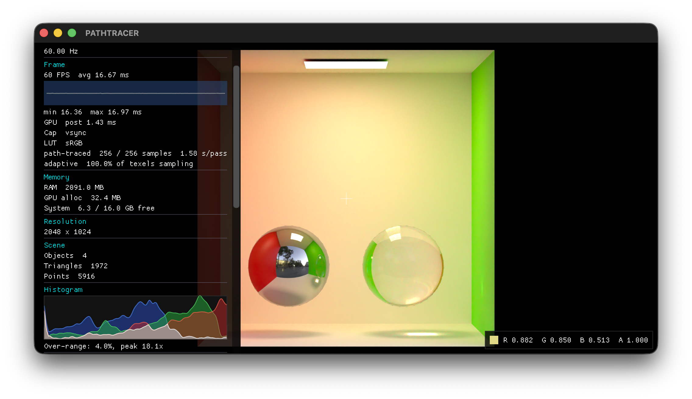

# PBR Pathtracer

*A physically-based unidirectional Monte Carlo path tracer with progressive sampling: Embree-accelerated, stochastic BSDF combined with environment-map NEE via MIS, behind a thin OpenGL display/HUD layer.*



## Build

C++20, built with CMake. Currently developed against macOS only.

```
brew install cmake glfw glew glm imath openexr opencolorio openimageio embree open-image-denoise openvdb
```
```
git submodule update --init --recursive
cmake -B build
cmake --build build
```

## Run

```
./build/pathtracer [-scene path/to/scene.json] [-stats] [-bench log.jsonl] [-bench-aovs beauty,normal,...] [-size WxH] [-max-samples N]
```

## Test

```
cmake -B build -DPython3_EXECUTABLE=/path/to/python   # with pytest, numpy, OpenEXR and Imath, so api.python is registered
ctest --test-dir build -j4
```

## Controls

| Input | Action |
| --- | --- |
| `W` / `S` | Fly forward / back |
| `A` / `D` | Fly left / right |
| `Q` / `E` | Fly down / up |
| LMB drag | Orbit about the surface under the view centre |
| `0` | Reset camera to the `profile.json` pose |
| `L` | Cycle viewer LUT: sRGB -> Rec.709 -> Raw |
| `R` / `G` / `B` | Isolate a channel; the active one again clears it |
| `I` | Invert the display |
| `H` | Toggle the HUD |
| `Esc` | Quit |

## Python

```
cmake --build build --target pathtracer_c
pip install -e python
```

The package finds the library in the source tree only; for any other install set `PATHTRACER_LIB` to the built `pathtracer_c` library. The library is not bundled, and there is no Windows candidate.

```python
from pathtracer import Renderer

renderer = Renderer("scenes/cornell.json")
frame = renderer.render(aovs=("beauty", "depth", "normal"), width=128, height=64, samples=8, seed=1)

frame["beauty"]   # (64, 128, 3) float32, linear ACEScg radiance
frame["depth"]    # (64, 128, 1) float32, camera-space Z
```

## Roadmap

### Problems

Output that is wrong, lossy or unverified, most serious first.

| Area | Item | Detail | Complexity | Status |
| --- | --- | --- | --- | --- |
| Validation | Grazing transmission | The transmissive energy test scores normal incidence only. Binned radially at roughness 0.2 it reads 0.9450 at 90% of the silhouette radius and 0.9020 at 95%, against 1.0000 at the centre, non-monotonic in roughness and absent by 0.7, measured before the OpenPBR interface. Instrument and re-measure first, then fix any loss. It gates authoring rough glass. | high | ready |
| Validation | Curved transmissive epsilons | Reverting either curvature-scaled epsilon leaves the suite green. Needs rough glass against an opaque backdrop, which has no closed form, so a converged-reference or two-estimator invariant. | medium | ready |
| Texture | Minification filtering | Primary hits ship: base colour, specular and a shown sky are filtered over the camera differential’s stratum. Secondary vertices still read level 0 at a point, so the stump’s 4K maps keep about 2000 level-0 tiles each resident; they need differentials propagated through each BSDF bounce. Normal, bump and roughness need appearance-preserving filtering first: prefiltered normals shorten and shade flatter (Toksvig 2005), 13% brighter on the minified stump, so their lost slope variance must move into roughness (Olano and Baker 2010). | high | ready |
| Validation | Untested paths | Gabor response magnitude, GPU and CPU display parity, the display texture upload (the suite has no GL context), the histogram binning (extract it so the CPU can test it), and a standing false-rejection rate for derived tolerance bands. | medium | ready |
| API | Display optics | Bloom and chromatic aberration run only in the viewer’s display shaders, so Python and `render_beauty` output carry neither. Each needs a CPU form applied to scene-linear Beauty before exposure, as the viewer applies it: the equal-weight Gaussian pyramid (Jimenez 2014), energy-conserving, and the radial per-channel offset. Exposed as `render` arguments that leave the output bit-identical at 0, with a GPU parity check. Bloom stays refused on the hexagonal lattice. | medium | ready |

### Features

Capability the renderer lacks, most valuable first.

| Area | Item | Detail | Complexity | Status |
| --- | --- | --- | --- | --- |
| Transport | Volume emission | Emission and temperature grids as volume radiance, gathered at real collisions by the same spectral tracking, with blackbody colour from temperature. The absorbed event becomes an emission vertex rather than a termination. | medium | ready |
| Transport | Bounded media | OpenPBR's `transmission_scatter` and `subsurface_radius` as homogeneous media inside closed surfaces, tracked by the same free-flight and ratio-tracking code against a constant majorant. Needs a nested medium stack in place of today's single level. | high | ready |
| Sampling | Adaptive sampling | Variance-driven per-pixel sample budget. The error estimate it needs already ships (the SNR’s replicate means). Foveal density is the same mechanism with an eccentricity weight. | medium | ready |
| Camera | Scene graph and instancing | Geometry is baked to world space and duplicated per node. A scene graph would unlock motion blur and real instancing. | high | ready |
| Colour | Photometric calibration | Tie radiometric output to lux and candela through the CIE ȳ curve, so EV100 can be checked against a light meter. | medium | ready |
| Camera | Lens model | Equisolid, stereographic and orthographic projections are reachable only as truncated degree-9 polynomials, with error growing toward the circle edge; equidistant is exact at k = 0. Each family is a closed-form θ(r) with no root-finding. Also a calibrated principal point and non-square pixels: one focal length means fx = fy and a centred circle, so only a calibration's radial geometry transfers. | medium | ready |

### Parked

Refinements, speculative or blocked; not scheduled.

| Area | Item | Detail | Complexity | Status |
| --- | --- | --- | --- | --- |
| BSDF | Smith-exact transmission | Refraction’s shadowing and the reflected share of multiple scattering are already exact in energy; the transmitted multiple-scattering lobe is still a `(1 − escape) cos` shape and is not reciprocal. | high | ready |
| Texture | Lookup cost | A TextureSystem lookup costs about twice a direct bilinear on the stump (12.2 ms against 5.6); secondary differentials would cut the level-0 traffic. | medium | ready |
| Texture | Aliasing test asset | A high-frequency noise material that exposes minification aliasing before and after. | low | ready |
| Sampling | Blue noise beyond one dimension | The mask is a scalar array, so a pixel's shift lies on a line; an annealed d-dimensional matrix (Georgiev and Fajardo 2016) fixes it. | medium | ready |
| Colour | HDRI white balance | An HDRI keeps the colour it was measured under; a CAT16 von Kries matrix from the authored kelvin to D65 would balance it. | medium | ready |
| Colour | Measured-observer cones | Needs the Judd-Vos matching functions and spectral primaries, so it lands with spectral transport. | high | blocked |
| Camera | Anamorphic and distortion | Anamorphic squeeze and Brown-Conrady or STMap distortion, each needing an inverse for motion vectors and a Jacobian for ray differentials. | high | ready |
| Camera | Hexagonal neighbourhoods | Sobel, Gabor, DoG, Denoised and bloom are refused on the hexagonal lattice; each needs its hexagonal form. | high | ready |
| Camera | Compound-eye optics | A per-cell Gaussian acceptance angle (Land 1997) as an angular filter on the primary ray. | medium | ready |
| Camera | Subdivision surfaces | Needs a scene-JSON flag and tessellation before the BVH build; follows the scene graph. | high | blocked |
| AOV | Contrast sensitivity | Barten 1999 on the shared scale space with Peli contrast; needs luminance in cd/m². | high | blocked |
