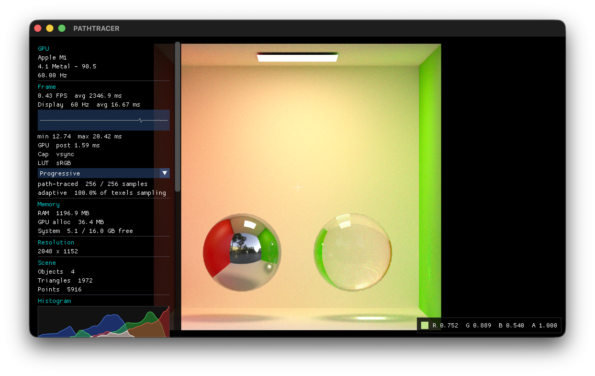

# PBR Pathtracer

*A physically-based unidirectional Monte Carlo path tracer with progressive sampling: Embree-accelerated, stochastic BSDF combined with environment and area-light NEE via MIS, behind a thin OpenGL display/HUD layer.*



## Build

C++20, built with CMake. Currently developed against macOS only.

```
brew install cmake glfw glew glm imath openexr opencolorio openimageio embree open-image-denoise openvdb boost
```
```
git submodule update --init --recursive
cmake -B build
cmake --build build
```

## Run

```
./build/pathtracer [-scene path/to/scene.json] [-preset beauty|proxy|research] [-stats] [-bench log.jsonl] [-bench-aovs beauty,normal,...] [-size WxH] [-spp N]
```

## Presets

`assets/config/profile.json` holds every setting. Each file in `assets/config/presets/` is a named preset and an RFC 7396 merge
patch over it. Select one with `-preset NAME`, `render_beauty --preset NAME`, `Renderer(scene, preset="NAME")` or
`pt_renderer_open(..., "NAME", ...)`. `beauty.json` is empty, so beauty is `profile.json` as is. An override may only replace keys
`profile.json` has, kind for kind, and anything else is refused at load.

| Preset | Size | spp | Interactive scale | Camera |
| --- | --- | --- | --- | --- |
| beauty (default) | 2048x1152 | 256 | 0.1 | square pixels, rectilinear lens |
| `proxy` | 512x256 | 16 | 1.0 | as beauty |
| `research` | 64x32 | 64 | 1.0 | hexagonal pixels, omnidirectional lens, inside the box |

`proxy` is the benchmark workload: `-bench`, `render_beauty` and `gbuffer_bench` default to its size and samples.

## Test

```
cmake -B build -DPython3_EXECUTABLE=/path/to/python   # with pytest, numpy, OpenEXR and Imath, so api.python is registered
ctest --test-dir build -j4
ctest --test-dir build -C Calibration -L calibration -j8   # opt-in, hours: how often each statistical test fails by chance
```

The `display_gl` tests open a hidden OpenGL window and report Not Run where none can be created.

## Controls

| Input | Action |
| --- | --- |
| `W` / `S` | Fly forward / back |
| `A` / `D` | Fly left / right |
| `Q` / `E` | Fly down / up |
| LMB drag | Orbit about the surface under the view centre |
| `0` | Reset camera to the profile's pose |
| `L` | Cycle viewer LUT: sRGB -> Rec.709 -> Raw |
| `R` / `G` / `B` | Isolate a channel; the active one again clears it |
| `I` | Invert the display |
| `H` | Toggle the HUD |
| `Cmd` + `-` / `=` | Zoom the image out / in by powers of two; it opens fitted to the window and never zooms past fit |
| `Esc` | Quit |

## Python

```
cmake --build build --target pathtracer_c
pip install -e python
```

The package finds the library in the source tree only; for any other install set `PATHTRACER_LIB` to the built `pathtracer_c` library. The library is not bundled, and there is no Windows candidate.

```python
from pathtracer import Renderer

renderer = Renderer("scenes/cornell.json", preset="proxy")  # beauty when omitted
frame = renderer.render(aovs=("beauty", "depth", "normal"), width=128, height=64, samples=8, seed=1)

frame["beauty"]   # (64, 128, 3) float32, linear ACEScg radiance, luminance in cd/m^2
frame["depth"]    # (64, 128, 1) float32, camera-space Z
```

## Roadmap

Ordered by execution, easy wins first. ETA is agent working hours to a complete, tested item.

| Area | Item | Detail | Complexity | ETA | Status |
| --- | --- | --- | --- | --- | --- |
| Cleanup | Remove analysis AOVs | Remove Sobel, Gabor, Colour Opponent, Contrast Sensitivity and Lookahead AOVs with their variants, bindings and tests. | medium | 1 h | ready |
| Output | AOV contact sheet | Write every AOV of a frame as one labelled mosaic, each tile through its display mapping, composed with OIIO ImageBufAlgo. | medium | 1 h | ready |
| Camera | Hexagonal cropping | Rows are √3/2 apart, so a W×H hexagonal image covers 0.87 of the film's height. Derive rows from field of view and lattice pitch. | medium | 1 h | ready |
| Camera | Lens model | Fisheyes lose accuracy near the edge. Generic polynomial model (Kannala and Brandt 2006) with principal point and pixel aspect. | medium | 1 h | ready |
| Camera | Motion vectors review | Verify camera motion as the analytic reprojection across every projection, lattice and the omnidirectional seam. | medium | 1 h | ready |
| Light | IES profiles | Lights emit uniformly. Measured distributions (IES LM-63), importance-sampled from the table and scaled by the existing lumens. | medium | 1 h | ready |
| Geometry | Displacement bounds and black edges | Black edges on geometry; find the root cause. Bound the terminator lift (Chiang et al. 2019) by triangle geometry and rounding error. | medium | 2 h | ready |
| Camera | Sensor noise model | Images are noise-free. Shot, read and dark noise and quantisation per EMVA 1288, from the calibrated luminance. | medium | 2 h | ready |
| Cleanup | Codebase review | Remove dead code, duplicated logic, needless abstraction, redundant copies and loop-invariant work, output unchanged. | medium | 3 h | ready |
| Validation | Derived test tolerances | 33 tests use literal tolerances or fixed seeds (UNDERIVED under -C Calibration). Derive each band from standard error and alpha. | medium | 3 h | ready |
| BSDF | Smith-exact transmission | Rough glass multiple scattering uses a lopsided approximation. Random walk on the Smith microsurface (Heitz et al. 2016). | high | 3 h | ready |
| BSDF | Normal-map noise | Multi-facet bounces on normal-mapped glossy surfaces have infinite variance; rough glass fails its sampling calibration. | high | 4 h | ready |
| Texture | Minification filtering | Unfiltered maps and checker. OIIO mips by ray-cone width, LEAN normals (Olano and Baker 2010), analytic box-filtered checker. | high | 3 h | ready |
| Sampling | Blue noise beyond one dimension | The mask spreads error in one dimension only. Blue-noise-distributed Sobol scrambling and ranking (Heitz et al. 2019). | medium | 2 h | ready |
| Sampling | Many-light sampling | Lights are picked uniformly. Light tree by power and orientation (Conty Estevez and Kulla 2018), then ReSTIR (Bitterli et al. 2020). | high | 6 h | ready |
| Performance | A/B tuning | Small local speed-ups, kept only on a significant paired-run gain on the proxy profile with output inside calibrated bands. | medium | 3 h | ready |
| Sampling | Bidirectional paths | Light and eye subpaths joined by MIS (Veach and Guibas 1995) so caustics converge. Waits for Smith-exact transmission. | high | 8 h | blocked |
| Camera | Anamorphic and distortion | Anamorphic squeeze and Brown-Conrady distortion (Brown 1966), Newton-inverted for motion vectors and texture filtering. | high | 2 h | ready |
| Camera | Event camera output | Log-contrast events for neuromorphic sensors, timed by interpolating between rendered frames (Rebecq et al. 2018). | medium | 3 h | ready |
| Camera | Multi-viewpoint compound eyes | Facets share one viewpoint and angle. Per-facet position, axis and acceptance from measured eye data (Millward et al. 2022). | high | 3 h | ready |
| Colour | Spectral transport | Per-path wavelength sampling (Wilkie et al. 2014) by channel sensitivity; spectral upsampling of textures (Jakob and Hanika 2019). | high | 6 h | ready |
| Colour | Measured-observer cones | Colour vision from CIE 2006 cone fundamentals (Stockman and Sharpe 2000). Waits for spectral transport. | high | 1 h | blocked |
| Light | Polarisation | No polarisation state. Stokes-Mueller transport (Wilkie and Weidlich 2012) with a polarised sky (Wilkie et al. 2004). | high | 6 h | ready |
| Geometry | Scene graph and instancing | Every copy is stored separately. Embree two-level instancing under a transform hierarchy. | high | 5 h | ready |
| Geometry | OpenUSD scenes | Read USD meshes, transforms, instancing, UsdLux lights and UsdShade OpenPBR materials onto the scene graph. Waits for scene graph. | high | 6 h | blocked |
| Geometry | Subdivision surfaces | Smooth surfaces from coarse meshes via OpenSubdiv at load, honouring USD subdivision schemes. Waits for OpenUSD. | high | 2 h | blocked |
| Geometry | Geometry motion vectors | Moving geometry reads as static. Reproject hits by previous instance transforms and USD time-sampled points. Waits for OpenUSD. | medium | 2 h | blocked |
| Output | Upscaling | Spatial or temporal (Xiao et al. 2020); temporal reads motionVector. Never replaces the converged Beauty. | medium | 3 h | ready |
| Output | Generative channel | Diffusion refinement AOV and latents (Ho et al. 2020; Rombach et al. 2022) from the Denoised AOV. Never replaces Beauty. | high | 6 h | ready |
| Performance | Wavefront rearchitecture | Single-ray inline shading caps throughput. Embree streams with material-sorted shading (Laine, Karras and Aila 2013), before GPU. | high | 16 h | ready |
| Performance | GPU denoising | Move Open Image Denoise to its GPU device, output unchanged. Waits for a GPU backend after wavefront. | medium | 2 h | blocked |
